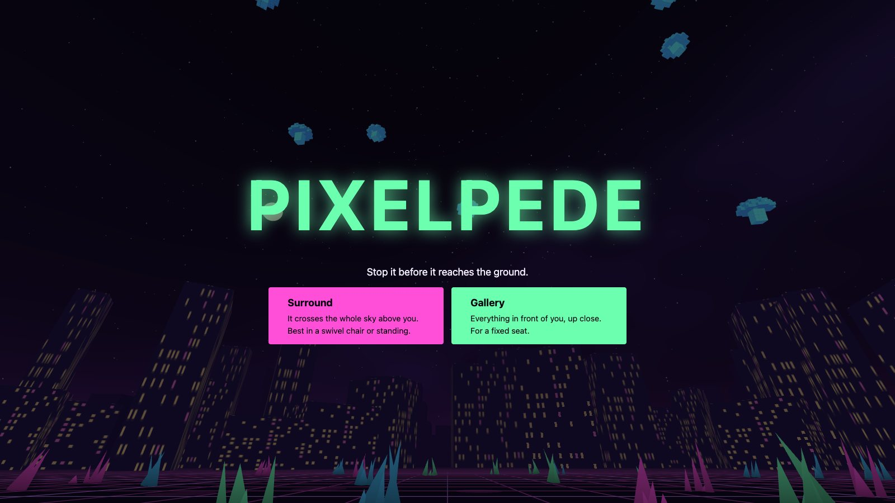
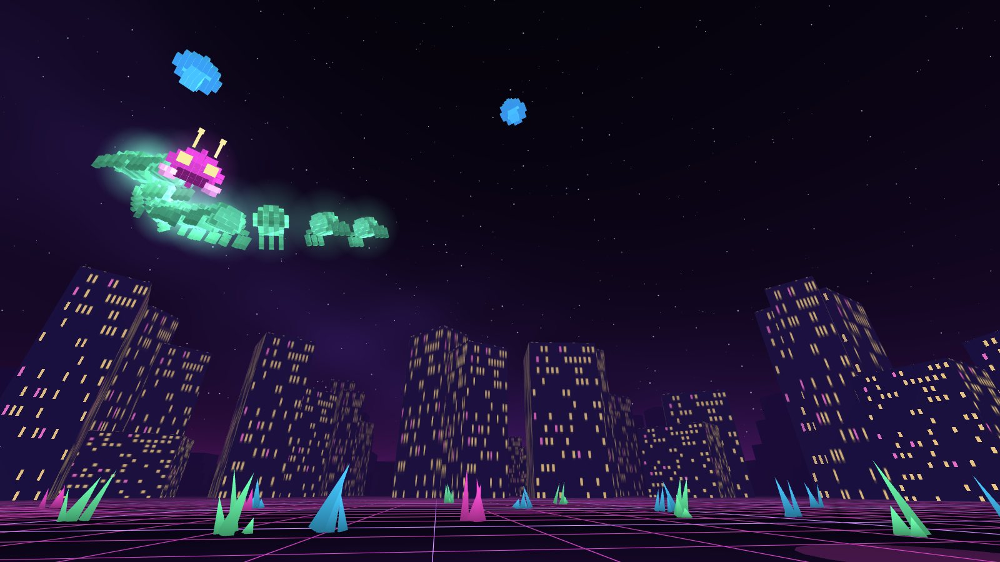
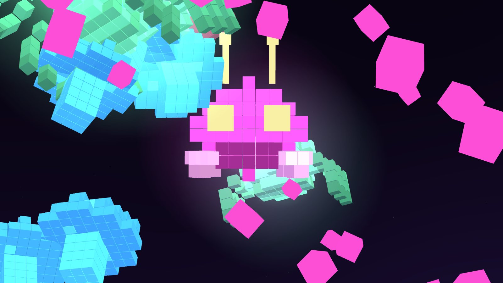
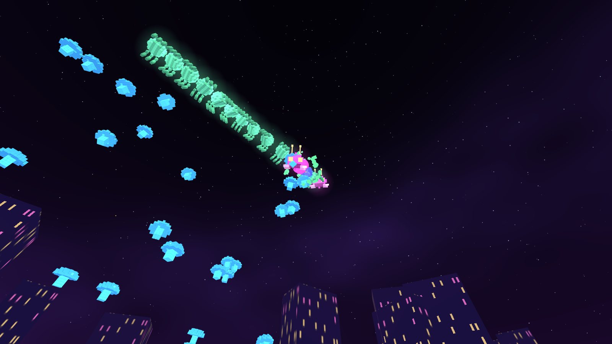

# Pixelpede

**[Play it in your browser or on a Quest](https://majonesmax.github.io/pixelpede/)**

A neon VR arcade shooter for Meta Quest 3, built with three.js and WebXR. A giant voxel creature
winds down out of the night sky toward you, through a field of floating mushrooms, while a bug
skitters across the ground for your feet. Shoot it in the middle and it splits in two. Everything
you see and hear is generated in code: the game uses no image or audio files.

It's an original game, inspired by the classic arcade shooters where a segmented creature
descends a field of obstacles.

This was built with [Claude Code](https://claude.com/claude-code), by a developer directing it
through headset playtests.

|                                   Surround mode                                    |                                    A head up close                                     |
| :--------------------------------------------------------------------------------: | :------------------------------------------------------------------------------------: |
|  |  |

_Captured in a desktop browser._

## Modes

- **Surround:** the field arches over you. The creature starts high behind you, crosses straight
  overhead and comes down in front. Best standing or in a swivel chair.
- **Gallery:** the whole field sits in a close arc in front of you, for a fixed seat.

## Playing

| Action               | Quest                       | Desktop                |
| -------------------- | --------------------------- | ---------------------- |
| Aim                  | Controller                  | Mouse                  |
| Fire                 | Either trigger (dual-wield) | Click and hold         |
| Slide along the rail | Thumbstick                  | A and D, or arrow keys |
| Restart              | B                           | B                      |

- **The creature:** each section you shoot leaves a mushroom behind. Hitting the middle splits it
  into two creatures heading opposite ways, so shooting heads first keeps things manageable.
- **The bug:** it zigzags along the ground toward you. Listen for its warble, which comes from
  wherever it is.
- **The diver:** an orange dart that plunges down a column, seeding new mushrooms as it falls.
- **Lives:** you lose one if a creature reaches the ground or the bug reaches you. Damaged
  mushrooms are repaired before the next attempt.

## Running it

You need Node 20.19 or newer.

    npm install
    npm run dev

Open the `https://` address it prints, and accept the self-signed certificate. On a Quest, use the
network address from the Quest browser, on the same Wi-Fi.

`npm test`, `npm run typecheck`, `npm run lint` and `npm run build` run the checks and build.
Pushing to `main` deploys to GitHub Pages.

## How it's put together

- `field.ts` maps the game's grid of columns and rows onto 3D space, as an overhead vault or a
  forward arc, with rolling depth so things sit at different distances.
- `creature.ts` holds the creature rules (stepping, turning, splitting, waves) as plain functions
  with tests.
- `game.ts` runs the frame loop: input, shots, enemies, drawing. Every creature section, mushroom
  and shot is an instanced mesh, so hundreds of them cost a few draw calls.
- `models.ts` builds the voxel models from code, `world.ts` the sky, ground and city, and
  `audio.ts` synthesizes every sound with the Web Audio API.

## License

MIT. See [LICENSE](LICENSE).
